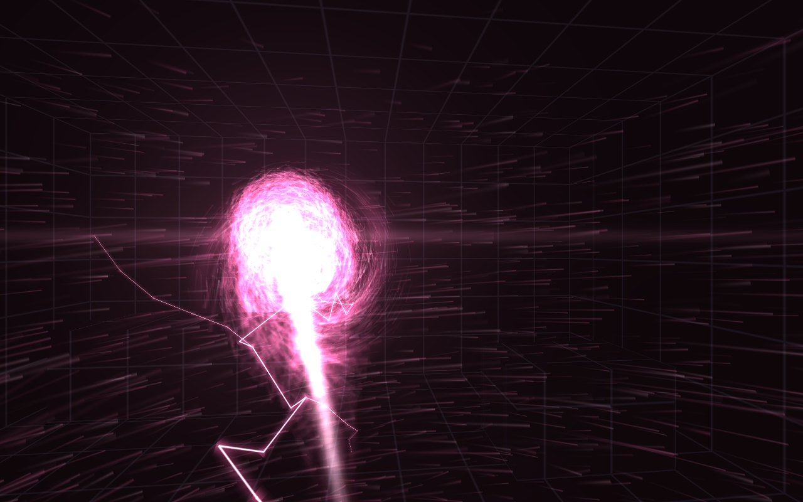
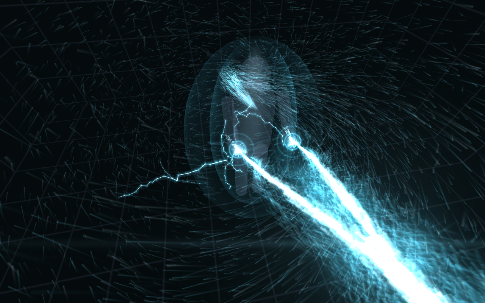
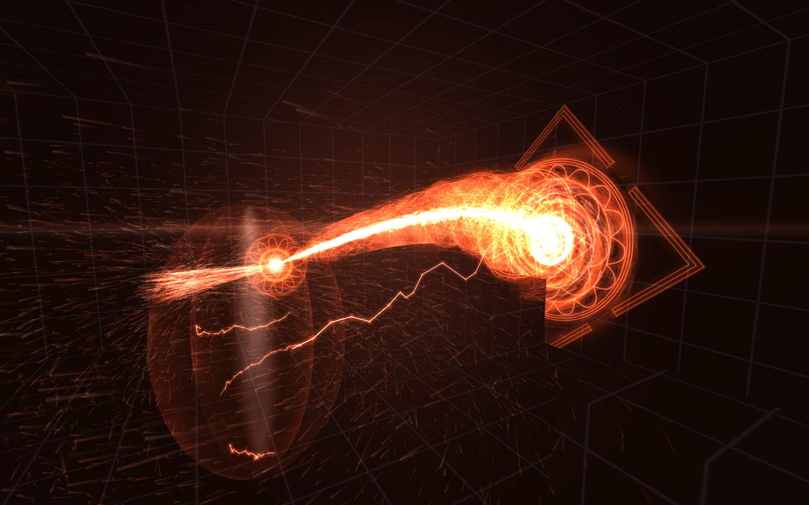

# Energy Flow AR

A mixed-reality (passthrough) web app for **Meta Quest 3**. You see your own room. Point at any wall or piece of furniture with your hand, pinch, and a larger-than-life torrent of luminous energy swirls out of that spot like a hurricane and pours into your chest. When it reaches you it passes through your body, wraps you in an aura and crackling lightning, and fills the room around you.

Hands only, no controllers. The qualities and their colours come from Puja VR.

**Open it:** https://utubevsr-sketch.github.io/energy-flow-ar/

## How to use it on Quest 3

1. Put on the headset and open the **Meta Quest Browser**.
2. Go to the address above and tap **Enter AR**. Allow the permissions it asks for: hand tracking and spatial data (the spatial data lets it find your walls).
3. Put the controllers down. Hand tracking turns on by itself.
4. A thin glowing ray comes out of each hand. Where it touches a real surface you see a glowing ring.
5. **Pinch** (thumb and index finger) to cast a flow from that spot. The vortex spins up on the surface for about a second, then the torrent races to you and keeps flowing.
6. The flow follows you as you move. It keeps going until you press **Clear flows**.

### The menu (on your left hand)

The menu never floats in front of you. **Turn your left palm toward your face** and hold it there for a moment: the menu appears just above your left hand, facing you. Turn the palm away and it fades out after about half a second. When you first enter AR, a short hint reminds you of this.

Press buttons with your right hand: point the ray at a button and pinch, or poke it directly with your right index fingertip. A pinch on the menu never casts a flow.

- **Set 1 to Set 5**: the five quality sets (24 qualities) from Puja VR.
- The qualities of the set, each with its colour, and **All of this set together** (a flow in all the set's colours).
- **Receive into**: Auto (the default), Heart or Palms. See below.
- **Intensity**: Gentle, Strong (the default) or Torrent.
- **Sacred geometry**: On (the default) or Off.
- **Clear flows**: fades out every flow.

The hand menu needs hand tracking. With controllers only (or in the desktop preview) the menu stays fixed where it first appears. Your choices are saved for next time.

### Room setup (for surface hit-tests)

The app uses the Quest's knowledge of your room to find walls and furniture. If you have not done so, run **Settings → Physical space → Space setup** and mark your walls and furniture. Without it, a pinch casts the flow from a point in the air 2.5 m along your ray (the ring then looks dimmer).

## Heart or palms

- **Heart:** the torrent strikes the middle of your chest, about 23 cm below your eyes and 15 cm in front. It arrives on a gentle, nearly level arc, so it does not sag down to your stomach.
- **Palms:** the torrent splits at the end and pours into the centre of each palm. If one hand is tracked it goes into that palm.
- **Auto** (the default): hold up an open hand with the palm facing where the flow comes from, and the flow pours into that palm. Do it with both hands and you get two streams. Lower your hands or close them and it goes back to your heart. The switch blends smoothly over about 0.3 s.

**Motes into your hands:** while the energy is flowing into you, small motes of light appear a few centimetres in front of each palm. They are pulled into the palm centre, run up the inside of your forearm and fade about 25 cm past the wrist. The motes are stronger and faster while that palm is receiving the torrent.

Quest hand tracking gives the joints of the hand and wrist, but not the forearm or elbow. So the forearm line is estimated from the wrist joint: it runs straight back from the wrist, away from the fingers. The palm centre comes from the middle-finger joints and the palm direction from the hand's joint orientation.

## When the energy reaches you (the arrival)

- **Through you:** the torrent does not stop at your chest. It carries on out of your back and sides and fans out into a slowly turning swirl around your whole body, from the floor to above your head, then drifts out into the room and fades.
- **Aura:** layered shells of light around your body, from your head to the floor, with a white-hot core, pulsing.
- **Lightning:** jagged, branching arcs, rebuilt every 2 to 4 frames, wrap your torso and arms. Some reach out to the flow's source, to the surfaces you pointed at, or to points 1 to 2.5 m away. Sparks fly where they strike.
- **Your hands crackle:** with hand tracking your fingertips and palms glow, small arcs jump between your fingers, and an arc jumps between your hands when they are within 40 cm of each other. Motes of light flow into your palms and up your forearms (see above).
- **Flare and bloom:** a soft wash of the quality's colour and a horizontal lens-flare streak across the incoming torrent. It gets stronger when you look straight at the flow. It is capped so you can always see your room (about 35% at the peak, then a gentle pulse around 10%).
- **Crescendo:** for about 1.5 s on arrival there is a big burst, with ring shockwaves expanding through the room at chest height and along the floor and a deep whoosh. Then it settles into a calmer, sustained state with electric crackle for as long as the flow runs.

**One colour for everything:** every layer is tinted in the selected quality's colour. That covers the torrent, vortex, beam, aura, lightning, sparks, hand glow, flare, shockwave and the pointing ray. Cores can go white-hot. "All of this set together" uses the set's colours on every layer. When you choose a different quality, flows that are already running change to the new colour over about a second. Dark colours (for example Restraint) are lifted, and pale ones (for example Divine Justice) get a stronger tint, so they still read clearly. Deep Connection with the Divine stays pure white.

## Sacred geometry

Thin, glowing linework sits alongside the effects, in the quality's colour. It never covers the torrent, and you can turn it off in the menu.

- **At the source:** a Sri Yantra is etched into the vortex on the surface: nine interlocking triangles, the bindu, 8- and 16-petal lotuses, three circles and the bhupura square with its gates. It fades in as the vortex spins up and turns slowly anticlockwise as you see it.
- **Along the torrent:** five rings, each a hexagram inside the Seed of Life, travel with the flow toward you. They are spaced by the golden ratio and spin anticlockwise with the torrent.
- **Golden-ratio structure:** the vortex's three spiral arms are golden spirals (the radius grows by phi every quarter turn), and the particles start at golden-angle steps (137.5°, as in phyllotaxis).
- **At the heart:** when the flow arrives, an Anahata mandala (a 12-petal lotus around a hexagram) blooms at the chest impact, facing you. It is kept faint and small this close to your eyes.
- **On the palms:** a small Sri Yantra glows on each palm while it receives the flow.
- **Crescendo:** Metatron's Cube over the Fruit of Life expands with the shockwave ring, turning the same way as the swirl around your body.

Everything is drawn by the app itself when it starts. There are no image files.

## Spin direction

The vortex on the surface, the spiral into it, the torrent, the rings and both palm streams all turn **anticlockwise as you look toward the source**. The swirl around your body keeps its own turn (clockwise seen from above), and the geometry around the body follows it. `?demo&cam=src&noroom` puts the preview camera where the energy lands, looking at the source, which is how the spin was checked.

## Sound

There is a rumble and whoosh that follows how much energy is flowing, a rising tone when you cast, a chime when the energy reaches you, a deep whoosh on arrival and electric crackle with the lightning. Sound starts when you tap Enter AR.

## Desktop preview

Open the page in a normal browser. You get a dim stand-in room. Drag to look around, click a wall or the furniture to cast a flow, and click the panel to choose.

For screenshots and checks:

| URL | Shows |
| --- | --- |
| `?demo` | First-person view of a flow from the front wall |
| `?demo=side` | Third-person view of the flow going to a stand-in person |
| `?demo=arrival` | Third-person view of the arrival, with a translucent stand-in body and stand-in hands |
| `?demo=menu` | A stand-in left palm turned toward you, showing the hand menu |
| `?demo=palms` | The stand-in person holds both palms out to the flow: two streams, one into each palm (`&cam=hand` gives a close-up of the motes) |
| `&recv=0..2` | Receive into Auto, Heart or Palms |
| `&set=0..4&q=0..4` (`q=-1` is all together), `&i=0..2` | Quality and intensity for the demo |
| `&stop=2.4` | Runs in fixed steps to that many seconds after the cast, then freezes (2 s is about when the energy arrives) |
| `&hide=disk,sheath,haze,core,streaks,chest,yantra,rings` | Turns flow layers off, for tuning |
| `&cam=src`, `&noroom` | Camera at the target looking at the source, and no stand-in room (used to check the spin) |

Screenshots are in [`screenshots/`](screenshots/).

## Guesses to confirm

- Up to **3 flows** at once. A fourth replaces the oldest.
- A flow keeps going **until you clear it**.
- Timings: the vortex spins up in about 0.8 s, the torrent takes about 1.2 s to reach you, and the arrival crescendo lasts about 1.5 s.
- The funnel and vortex sizes scale with distance (funnel mouth 0.3 to 0.8 m, swirl on the surface 0.6 to 1.5 m), so a nearby surface does not swamp you.
- The heart target is 23 cm below and 15 cm in front of your eyes.
- In Auto, a palm receives when it is open (fingertips on average more than 6.5 cm from the palm centre) and faces the flow's source (within about 60°).
- The hand motes run 25 cm past the wrist along the estimated forearm line.
- A new quality choice re-tints flows that are already running.
- The hand menu opens when the left palm faces your eyes (within about 50°) for 0.3 s, sits about 12 cm above the hand at 0.28 m wide, and closes 0.5 s after you turn away.
- The flare peaks at about 35% wash and settles to about 10%.

## Technical notes

- WebXR `immersive-ar` session with Three.js r160 (vendored in `vendor/three/`). There is no build step, only `index.html` and `main.js`. `main.js` is loaded with a timestamp so the headset never runs a stale copy.
- Everything moves on the GPU: the torrent (9k, 18k or 30k streaks depending on intensity), the arrival swirl (7k streaks), the core beam, the sheath, the vortex and the haze are positioned analytically in shaders. Only the lightning (at most 420 segments), sparks and hand glow are updated on the CPU.
- Hit-test sources come from each hand's target-ray space. Hand joints come from `renderer.xr.getHand()`: the palm centre comes from the middle-finger metacarpal and proximal joints, the palm normal from the metacarpal's −Y axis, and the forearm line from the wrist's +Z axis. Foveation is set to 0.5.
- Glow blending adds colour while keeping alpha low (colour One/One, alpha One/OneMinusSrcAlpha), so the passthrough stays visible.
- Hosted on GitHub Pages from the `main` branch root.
